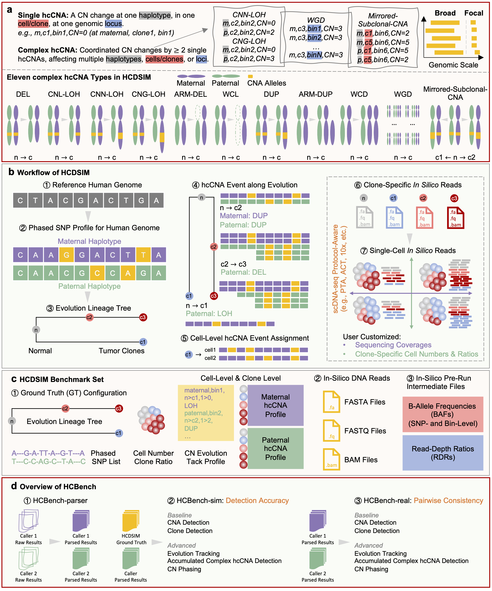

# HCBench

HCBench standardizes single-cell CNA caller outputs and evaluates them against simulated ground truth or against other callers.



## Installation

Use Python 3.10 or newer:

```sh
pip install git+https://github.com/compbioclub/HCBench.git@main
```

Installation includes NumPy, pandas (`>=2.0,<3`), SciPy, scikit-learn, and Biopython. Install the extras needed for your inputs or analysis:

```sh
# Read Alleloscope RDS files
pip install "hcbench[rds] @ git+https://github.com/compbioclub/HCBench.git@main"
# Run focal gene and pathway enrichment
pip install "hcbench[enrichment] @ git+https://github.com/compbioclub/HCBench.git@main"
```

VCF conversion needs [BCFtools](https://samtools.github.io/bcftools/howtos/install.html), and CNA phylogeny needs [Lazac](https://github.com/raphael-group/lazac-copy-number). Install them separately and put the required executable on `PATH`.

## Prepare your inputs

Choose the workflow for your data:

- [Parsers](parsers/index.md): convert CHISEL, Alleloscope, CNRein, SEACON, or SIGNALS outputs into CNA matrices.
- [HCBench-sim](gtbench/index.md): compare caller matrices with matching HCDSIM ground truth.
- [HCBench-real](realbench/index.md): compare at least two callers for the same sample; no ground truth is required.

A standardized CNA CSV has `region` as its first column and cell identifiers as the remaining columns. Combined values use `hap1|hap2` (for example, `2|1`); split haplotype matrices contain numeric values. Keep caller names and input paths in the same order. Clone comparisons also need `clusters.csv` with `cell_id` and `clone_id`; read-depth and VAF analyses need their corresponding sequencing inputs.

## Initialize and run

`bin_size` and `genome` are required when creating a CNA parser, `GTBench`, or `RealBench`:

- `bin_size`: a positive integer in base pairs, such as `100000` for 100 kb. Use the resolution of your CNA data.
- `genome`: `"hg19"` or `"hg38"`, matching your input coordinates.

Methods use this configuration. Initialization prints:

```text
Bin size: 100000 bp
Genome: hg38
```

The following example compares two already standardized CNA files. Replace the paths and configuration with those for your sample:

```python
from hcbench.realbench import RealBench

bench = RealBench(bin_size=100000, genome="hg38", output_dir="output/realbench")
bench.cna_values(
    tool_cna_files=[
        "results/Alleloscope/haplotype_combined.csv",
        "results/CHISEL/haplotype_combined.csv",
    ],
    tool_names=["Alleloscope", "CHISEL"],
    outfile_prefix="cna_values",
)
```

This writes `cna_values_rmse.csv`, `cna_values_scc.csv`, and `cna_values_acc.csv` under `output/realbench/`. Each file is a caller-by-caller comparison matrix. See the workflow tutorials above for parsing, ground-truth evaluation, and other methods.

## Choose an event-analysis resolution

With the default event-size thresholds, analysis is available for:

| CNA `bin_size` | Event categories |
| --- | --- |
| `<= 3,000,000` bp | focal, medium, broad |
| `> 3,000,000` and `<= 10,000,000` bp | medium, broad |
| `> 10,000,000` bp | broad |

Event length is `End - Start + 1`: focal is below 3 Mb, medium is from 3 Mb through 10 Mb, and broad is above 10 Mb. Whole-chromosome and whole-genome events are reported as broad. Categories unavailable at your resolution have no annotation or category-metric rows; a missing comparison is reported as NA rather than evidence of no events.

`RealBench.focal_genes_and_pathways()` requires `bin_size <= 3,000,000`. At coarser resolutions it prints a skip message, returns `None`, and creates no new enrichment results. For supported resolutions, see the [focal gene and pathway tutorial](realbench/focal_genes_and_pathways.md).
